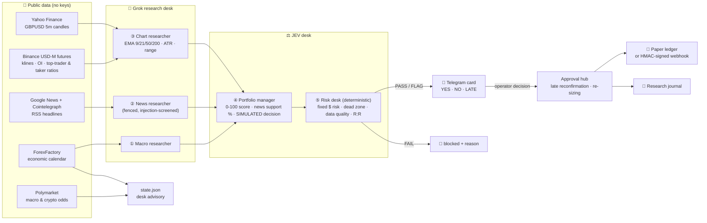
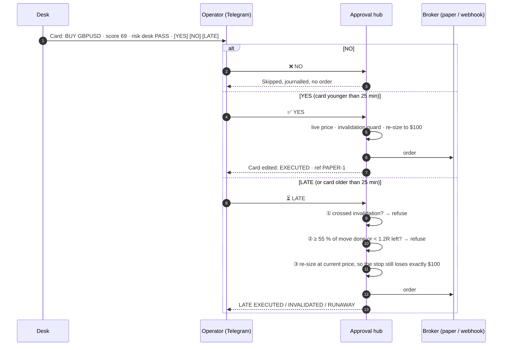

<div align="center">

# Grok + JEV Research Desk

**A multi-agent AI trading-research desk with a human in the loop.**
Five agents (macro, news, chart, portfolio manager and risk desk) read the market every few seconds.
They send you a Telegram card with **YES / NO / LATE** buttons and size every approved order to a
fixed dollar risk.

[](https://github.com/achupradeep3050/grok-jev-research-desk/actions/workflows/ci.yml)


[](LICENSE)

[Quick start](#-quick-start) · [How it works](#-how-it-works) · [Risk controls](#-risk-controls) ·
[Telegram](#-telegram-commands) · [Configuration](#-configuration) · [Limitations](#-limitations)

</div>

---

## ✨ What it does

| | |
|---|---|
| 🧠 **Five-stage agent pipeline** | Grok macro, news and chart researchers, then the **JEV** portfolio manager and the **JEV** risk desk |
| 🛡️ **Prompt-injection defence** | Headlines are sanitised, screened and fenced as `UNTRUSTED_ARTICLE` data before any model sees them |
| 📊 **Live public data, no paid feeds** | Binance USD-M futures (gold, BTC) · Yahoo Finance (GBPUSD) · ForexFactory calendar · Google News · Polymarket |
| 💵 **Fixed-dollar risk law** | Every order is sized so a stop-out loses exactly `RISK_PER_TRADE_USD` (default **$100**) |
| ⏳ **Late reconfirmation protocol** | Saw the card late? **LATE** re-checks invalidation, refuses runaway moves and re-sizes at the current price |
| 📱 **Telegram approval hub** | Interactive cards, operator whitelist, in-place card updates, research journal |
| 🧪 **Works with no keys at all** | Every Grok stage has a transparent deterministic fallback, and every report says which engine produced it |
| 🔌 **Pluggable execution** | Local paper ledger by default. An HMAC-signed webhook can hand approved orders to your own executor |

> [!IMPORTANT]
> This is a **research and decision-support tool**, not a profitable strategy. No edge has been
> measured or is claimed. Decisions are labelled *SIMULATED*. A human approves every order, and
> execution is **paper** unless you deliberately wire a webhook. Not financial advice.

---

## 🚀 Quick start

### Option 1: one-click AI install

Paste this into **Claude Code, Codex, Cursor, Gemini CLI, Hermes Agent** or any coding agent
that can run shell commands:

```text
Install the Grok + JEV research desk for me by following
https://github.com/achupradeep3050/grok-jev-research-desk/blob/main/docs/AI_INSTALL.md
exactly. Ask me for any key or setting you need, never print my secrets, keep execution in
paper mode, and finish by showing me the real output of `jevdesk doctor`.
```

The agent clones the repo, runs the installer and asks you for your keys. It writes them to `.env` (mode 600)
and verifies the install with `jevdesk doctor`. Its exact instructions are in [`docs/AI_INSTALL.md`](docs/AI_INSTALL.md).

### Option 2: one-line installer (macOS / Linux)

```bash
curl -fsSL https://raw.githubusercontent.com/achupradeep3050/grok-jev-research-desk/main/install.sh | bash
```

The installer clones the repo into `~/grok-jev-research-desk`, creates a virtualenv and installs the package.
It then asks for your keys (each one is optional) and runs the self-test, the unit tests and `jevdesk doctor`.
To install it as a background service (launchd or systemd), add `--service`:

```bash
curl -fsSL https://raw.githubusercontent.com/achupradeep3050/grok-jev-research-desk/main/install.sh | bash -s -- --service
```

### Option 3: Docker

```bash
git clone https://github.com/achupradeep3050/grok-jev-research-desk.git && cd grok-jev-research-desk
cp .env.example .env   # fill in your keys
docker compose up -d --build
```

### Option 4: manual

```bash
git clone https://github.com/achupradeep3050/grok-jev-research-desk.git && cd grok-jev-research-desk
python3 -m venv .venv && .venv/bin/pip install -U pip && .venv/bin/pip install -e ".[dev]"
cp .env.example .env
.venv/bin/jevdesk selftest && .venv/bin/jevdesk doctor
```

### First commands

```bash
jevdesk eval gold          # one deterministic research pass, printed as JSON
jevdesk eval gold --llm    # the same pass with Grok on every stage
jevdesk run                # start the desk: live feeds + Telegram cards
```

---

## 🧭 How it works



### The five stages

| # | Agent | Input | Output | Fallback without an LLM |
|---|---|---|---|---|
| ① | **Grok macro researcher** | USD/GBP/EUR calendar (high and medium impact) | macro bias, support score 0-100, risks | Imminent high-impact release → 35; quiet calendar → 60 |
| ② | **Grok news researcher** | Up to 12 sanitised, fenced headlines | stance (bull / bear / neutral / conflicted), **news-support %**, confidence | Weighted keyword classifier; conflicting headlines → `CONFLICTED` |
| ③ | **Grok chart researcher** | Explicit numbers only: price, EMAs, ATR(14), 30-bar range | technical bias, chart score, invalidation idea | Price vs EMA 50 + EMA 9/21 momentum |
| ④ | **JEV portfolio manager** | The three reports | **0-100 score**, evidence for and against, `SIMULATED BUY / SELL / WAIT` | 25 pts each: macro · news · chart alignment · data quality |
| ⑤ | **JEV risk desk** | The decision and the proposed order | `PASS / FLAG / FAIL` per check | Always deterministic. It is never delegated to the model. |

**JEV scoring** (deterministic engine). The chart score counts in the direction of the trade, so short
setups score as fairly as long ones:

```text
score = 0.25 × macro_support
      + 0.25 × news_support_%
      + 0.25 × (chart_score if BUY else 100 − chart_score)
      + data_quality (25 − conflicts 8 − low confidence 5 − macro risks 4 − stale data 15)
```

JEV answers **WAIT** in any of these cases: the news has no direction, news and chart disagree, the data is stale, or the score
is below 65. An automatic card also needs `score ≥ SIGNAL_MIN_SCORE` (68) and
`news support ≥ SIGNAL_MIN_NEWS_SUPPORT` (65 %), with one card per asset per 45 minutes at most.

---

## 🛡️ Risk controls



| Control | Rule |
|---|---|
| **Fixed-dollar risk** | Gold and BTC: `units = risk / \|entry − stop\|`. GBPUSD: `lots = risk / (stop pips × $10)`. Re-computed at the fill price. |
| **Dead zone** | No cards and no executions inside `DEAD_ZONE_UTC` (default 20:00-24:00 UTC, when spreads widen). Ranges that wrap past midnight are supported. |
| **Macro halt** | High-impact release within −5…+10 min → `HALT_OR_CLOSE`: automatic cards stop and an alert is broadcast |
| **Invalidation** | Halfway from entry to stop. A late entry beyond it is refused. |
| **Runaway guard** | A LATE entry is refused once 55 % of the move to target is done, or when less than 1.2R remains |
| **No made-up prices** | If a feed fails, the asset is reported unavailable and no order is placed. Stale data forces WAIT. |
| **One decision per card** | A card that is already executed, skipped or invalidated cannot fire twice |
| **Operator whitelist** | Only `TELEGRAM_OPERATOR_IDS` can send commands or press buttons. Others are ignored, in groups as well. |
| **Secrets hygiene** | Secrets live only in `.env`, and the bot token never appears in logs. CI runs gitleaks. |

---

## 📱 Telegram commands

| Command | What it does |
|---|---|
| `/status` | Desk advisory, price, decision, score, news support % and trend state for every asset |
| `/eval gold` · `/eval gbpusd` · `/eval btc` | Runs the pipeline now. You get a card (BUY/SELL) or the reason it is WAIT. |
| `/eval gold deep` | The same pass with Grok on every stage |
| `/signals` | Pending cards |
| `/positions` | Open paper/webhook positions (closed automatically at SL/TP in paper mode) |
| `/journal` | The last rows of the research journal |
| `/yes <id>` · `/no <id>` · `/late <id>` | Decides a card by text instead of buttons |

Setup takes two minutes. Create a bot with **@BotFather**, then get your numeric id from **@userinfobot**.
Put both into `.env`. To post cards to a group, add the bot to the group and put the group id (a negative number)
in `TELEGRAM_BROADCAST_CHAT_IDS`. Only operators can act on the cards.

---

## ⚙️ Configuration

All settings live in `.env`. See [`.env.example`](.env.example) for the full list.

| Variable | Default | Purpose |
|---|---|---|
| `XAI_API_KEY` | — | Grok key ([console.x.ai](https://console.x.ai)) |
| `LLM_BASE_URL` / `LLM_MODEL` | `https://api.x.ai/v1` / `grok-4.20-non-reasoning` | Any OpenAI-compatible endpoint (Ollama, LM Studio, OpenRouter, vLLM) |
| `LLM_IN_LOOP` | `false` | Re-run Grok on each automatic signal before it is sent |
| `TELEGRAM_BOT_TOKEN` / `TELEGRAM_OPERATOR_IDS` | — | Bot and the user ids allowed to act |
| `TELEGRAM_BROADCAST_CHAT_IDS` | operator ids | Where cards are posted |
| `RISK_PER_TRADE_USD` | `100` | Loss if a stop is hit |
| `DEAD_ZONE_UTC` | `20-24` | Flat hours (`off` to disable) |
| `MIN_LATE_RR` / `RUNAWAY_FRACTION` | `1.2` / `0.55` | Late-reconfirmation guards |
| `SIGNAL_MIN_SCORE` / `SIGNAL_MIN_NEWS_SUPPORT` | `68` / `65` | Thresholds for automatic cards |
| `AUTO_ASSETS` | `GOLD,GBPUSD` | Assets that may raise cards on their own (`none` = only `/eval`) |
| `EXECUTION_MODE` | `paper` | `paper` or `webhook` |
| `EXECUTION_WEBHOOK_URL` / `_SECRET` | — | Approved orders are POSTed as JSON, with the `X-JEV-Signature` HMAC-SHA256 header |

**Webhook payload** (verify the signature with your secret before acting on it):

```json
{"source": "jevdesk", "signal_id": "SIG-GOLD-1792781138", "asset": "GOLD", "action": "BUY",
 "entry": 4005.2, "sl": 4001.2, "tp": 4013.2, "size": 25.0, "risk_usd": 100.0, "sent_at": 1792781197.5}
```

---

## 🗂️ Project layout

```text
jevdesk/
├── __main__.py        CLI: run · eval · doctor · selftest
├── config.py          .env loader and settings (nothing hard-coded)
├── llm.py             OpenAI-compatible client (Grok default) + tolerant JSON parsing
├── feeds/
│   ├── market.py      Binance futures + Yahoo candles, EMA/ATR/range, positioning
│   ├── news.py        ForexFactory calendar, RSS headlines, keyword classifier
│   └── predictions.py Polymarket macro/crypto odds
├── research_desk.py   ① macro ② news ③ chart (prompt-injection defence)
├── jev_desk.py        ④ portfolio manager ⑤ risk desk
├── trend.py           EMA trend / momentum / midline comparator
├── engine.py          pipeline + desk advisory + state
├── approval.py        signal cards, YES/NO/LATE, late reconfirmation, re-sizing
├── broker.py          paper ledger · HMAC webhook
├── journal.py         markdown research journal
├── telegram.py        minimal Bot API client (no SDK)
└── daemon.py          the long-running desk
tests/                 pytest suite (sizing, scoring, guards, auth, webhook signing, parsing)
install.sh             one-line installer (+ launchd / systemd service)
docs/AI_INSTALL.md     step-by-step instructions for AI coding agents
```

Runtime files are written to `data/` and are git-ignored: `state.json`, `signals.json`,
`paper_ledger.json`, `journal.md` and `calendar_cache.json`.

---

## 🧪 Testing

```bash
jevdesk selftest     # 14 offline checks of the safety logic
pytest -q            # full unit suite
jevdesk doctor       # live check of every feed, the LLM and Telegram
```

CI runs on Python 3.9 and 3.12. It also runs the installer on a clean Ubuntu runner and scans the history with gitleaks.

---

## ⚠️ Limitations

- **No proven edge.** The scores are a structured way to read evidence. Nobody has validated them against a
  same-window control. Judge the journal over months before you trust anything.
- The deterministic fallbacks are simple heuristics: keyword sentiment and EMA structure. Grok is better at
  reading nuance, but it can still be wrong or overconfident.
- Binance top-trader and taker ratios describe crypto-exchange futures positioning only.
  They are not the institutional flow of the spot gold or FX markets.
- Stops and targets are fixed distances per asset (`jevdesk/assets.py`). Tune them for your timeframe.
- Paper fills happen at the quoted price, with no spread, slippage or commission.

## 🤝 Contributing

Issues and pull requests are welcome. Please keep the risk desk deterministic. Add a test for every new guard,
and never commit `.env` or anything under `data/`.

## 📄 License

[MIT](LICENSE). Use it, fork it and learn from it. Trading is risky, and you are responsible for your own decisions.
